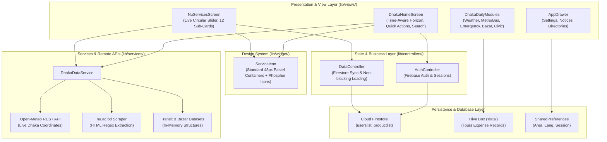
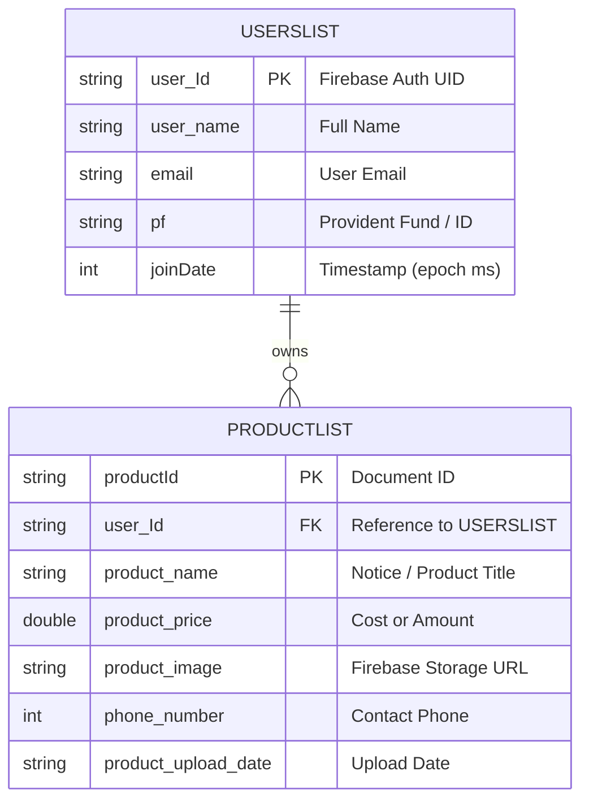

# DhakaLife (ঢাকা লাইফ) & AIS-NU — Universal Project Context

> **Canonical Project Documentation & AI Agent Handoff Knowledge Base**  
> **Target Path:** `D:\projects\AIS_NU\PROJECT_CONTEXT.md`

---

## 1. Document Metadata

| Metadata Field | Value / Status |
| :--- | :--- |
| **Project Name** | **DhakaLife** (ঢাকা লাইফ) / Legacy: `AIS-NU` (`flutter_project_nutcm_1`) |
| **Short Description** | Production-oriented Android Super-App for Dhaka daily-life services with an integrated National University (AIS-NU) administrative & academic portal hub. |
| **Document Version** | `1.1.0` |
| **Last Updated** | `2026-10-15` (ISO 8601: `2026-10-15T22:30:00+06:00`) |
| **Repository URL** | `https://github.com/mridulhaze/DhakaLife` |
| **Current Git Branch** | `main` (tracked with `origin/main`) |
| **Target Platforms** | Android (minSdkVersion: 21, compileSdkVersion / targetSdkVersion: 34+ via Flutter SDK) |
| **Maintenance Protocol** | Update this document whenever architectures, routes, models, business rules, dependencies, or handoff states change (see Section 24). |

---

## 2. Executive Summary

### What the Project Does
**DhakaLife** is a mobile super-application engineered for the citizens of Dhaka, Bangladesh, built on Flutter and Android. It integrates daily urban necessities—real-time weather forecasting, public transit guides (Dhaka Metro MRT-6 & verified bus routes), emergency response directories (Police, Fire, Ambulance, Blood Donors), live market commodity prices (TCB / Bazar prices in BDT), and civic reporting—into a single, Bangla-first, modern UI inspired by leading super-apps (like Pathao).

Simultaneously, the application hosts the full **AIS-NU (National University Academic & Information Services)** hub, serving university faculty, administrative staff, and affiliated college students with automated travel allowance/tour bill calculators, live circulars scraped directly from `nu.ac.bd`, employee directories, college directories, academic calendars, GCALL sheet synchronizers, and AI chat assistance.

### Key Architectural Milestones Recently Achieved
1. **Dynamic Time-Aware Ambient Horizon:** Replaced static solid banners with an animated sky simulation transitioning between morning sunrise (`#FF8A65`), golden noon, sunset/dusk peach (`#E64A19`), and midnight twilight.
2. **Phosphor Icon System:** Deployed unified 48px rounded pastel container icons across all home and sub-card features via a reusable `ServiceIcon` component.
3. **Live `nu.ac.bd` Notice Feed:** Implemented automated web-scraping with HTML regex parsers to fetch live official notices, categories, and PDF circulars from National University with pull-to-refresh capabilities.
4. **Production Release Pipeline & Custom Keystore:** Generated a 2048-bit RSA release signing key (`dhakalife_release.jks`, valid until 2054) and built a release APK (`DhakaLife_Release_v1.0.apk`) that eliminates Android Play Protect warnings.

---

## 3. Product Requirements and Scope

### Functional Requirements
- **Bangla-First Interface:** Default language in Bangla (`বাং | EN` toggle), formatting prices in BDT (`৳`), adhering to `Asia/Dhaka` timezone.
- **Guest / No-Login Access:** Public utilities (Emergency 999, Metro & Bus guides, Live Weather, Bazar prices, NU live notices) must work without requiring account authentication.
- **National University Services:**
  - Dynamic Notice Carousel scraping `https://www.nu.ac.bd/recent-news-notice.php`.
  - Tours Bill & TA/DA allowance calculators using established distance formulas and rates.
  - Searchable directories of employees, affiliated colleges, and district travel checkpoints.
  - Sync with GCALL spreadsheets for examination records.
- **Dhaka Daily Life Modules:**
  - Real-time weather fetched via Open-Meteo REST API for coordinates `23.8103° N, 90.4125° E`.
  - Metro Rail (MRT Line 6) station roadmap and verified Dhaka city bus routes.
  - 24/7 Hotline directory with direct one-tap calling integration (`url_launcher`).
  - Daily bazar tracker for staple commodities (Rice, Lentils, Eggs, Oil, Vegetables).
  - Civic problem reporting UI for road damage, waterlogging, and waste management.

### Non-Functional Requirements
- **Performance:** Optimized for budget Android smartphones; fluid 60fps animations via lightweight standard widgets.
- **Offline Resilience:** Local fallback caching for notices, static transit databases, and offline expense calculations via Hive.
- **Safety & Permissions:** Minimal invasive permissions (`INTERNET`, `ACCESS_NETWORK_STATE`, `RECORD_AUDIO` for voice bot). No background tracking without consent.

---

## 4. Complete Technology Stack

| Category | Technology / Library | Version | Purpose | Evidence / File | Status |
| :--- | :--- | :--- | :--- | :--- | :--- |
| **Language** | **Dart** | `3.10.3` | Core application programming language | `pubspec.yaml`, CLI verification | Verified |
| **Framework** | **Flutter SDK** | `3.38.4` (channel stable) | Cross-platform UI toolkit | `flutter --version` | Verified |
| **OS Target** | **Android** | API 21 – 34 | Primary distribution target | `android/app/build.gradle` | Verified |
| **Build System** | **Gradle** / AGP | `8.14` / `8.9.1` | Native Android build automation | `gradle-wrapper.properties` | Verified |
| **Java Runtime**| **OpenJDK** | `21.0.8` (LTS) | JDK executing Gradle & keytool | `java -version` | Verified |
| **State Mgmt** | **GetX** | `^4.6.6` | Navigation, dialogs, and controller state | `lib/controllers/` | Verified |
| **Iconography** | **phosphor_flutter** | `^2.1.0` | Primary modern vector icon library | `lib/widget/service_icon.dart` | Verified |
| **Cloud DB** | **Cloud Firestore** | `^4.7.0` | Cloud database for notices & user accounts | `lib/controllers/data_controller.dart` | Verified |
| **Cloud Auth** | **Firebase Auth** | `^4.2.2` | User authentication & sessions | `lib/controllers/auth_controller.dart` | Verified |
| **Cloud File** | **Firebase Storage** | `^11.1.1` | Image uploads for notice/product items | `lib/controllers/data_controller.dart` | Verified |
| **Local Storage**| **Hive** / **hive_flutter** | `^2.2.3` / `^1.1.0` | Local key-value & binary object box | `lib/data/utlity.dart` | Verified |
| **Preferences** | **shared_preferences** | `^2.0.8` | Local persistent user settings | `lib/utils/user_preferences.dart` | Verified |
| **Networking** | **http** | `^0.13.6` | REST API requests & web scraping | `lib/services/dhaka_data_service.dart` | Verified |
| **Deep Links** | **url_launcher** | `^6.1.11` | Dialing 999, opening notice PDFs & maps | `lib/views/dhaka_emergency_screen.dart` | Verified |
| **Charts** | **syncfusion_flutter_charts** | `^26.2.7` | Expense & financial visualization | `lib/widget/chart.dart` | Verified |
| **Animation** | **lottie** | `^2.3.2` | Vector Lottie animations | `assets/*.json` | Verified |
| **Slider** | **carousel_slider** | `^5.0.0` | Notice and alert carousels | `lib/views/nu_services_screen.dart` | Verified |
| **AI Assistant** | **dialogflow_grpc** / **dialog_flowtter** | `^0.2.9` / `^0.3.3` | DialogFlow assistant integration | `lib/chatBot.dart` | Verified |

---

## 5. Repository and Directory Structure

```text
D:\projects\AIS_NU\
├── android\                               # Native Android host project
│   ├── app\
│   │   ├── dhakalife_release.jks          # Production RSA-2048 release keystore (valid to 2054)
│   │   ├── google-services.json           # Firebase credentials (Project: cipher-847be)
│   │   ├── build.gradle                   # App-level build, signingConfigs & dependencies
│   │   └── src\main\
│   │       ├── AndroidManifest.xml        # Permissions, label="DhakaLife", icon="@mipmap/ic_launcher"
│   │       └── res\                       # Launcher icons (mipmap-mdpi to xxxhdpi)
│   ├── build.gradle                       # Project-level Gradle buildscript
│   ├── gradle\wrapper\                    # Gradle 8.14 distribution wrapper
│   └── settings.gradle                    # Plugin declarations (AGP 8.9.1, Kotlin 2.1.0)
├── assets\                                # Bundled static graphics, JSON, and Lottie animations
│   ├── icon\                              # High-resolution store icons (play_store_512.png)
│   ├── images\                            # Local banner graphics and portraits
│   └── json\                              # Dialogflow auth and configuration
├── lib\                                   # Core Dart / Flutter source code
│   ├── main.dart                          # App entry point (Firebase init & GetMaterialApp)
│   ├── controllers\                       # GetX state & business controllers
│   │   ├── auth_controller.dart           # Authentication, signup, login, session
│   │   ├── comman_dailog.dart             # Non-blocking loading & error dialog helpers
│   │   └── data_controller.dart           # Cloud Firestore data synchronization
│   ├── data\                              # Local storage & Hive data utilities
│   │   ├── model\add_date.dart            # Hive TypeAdapter data model for expense records
│   │   └── utlity.dart                    # Hive box calculations (income, expense, daily totals)
│   ├── models\                            # Data contracts and domain entities
│   │   ├── dhaka_life_models.dart         # Transit, weather, emergency, notices, bazar models
│   │   └── products_model.dart            # Product / notice upload entity
│   ├── services\                          # Remote data fetching & integration logic
│   │   └── dhaka_data_service.dart        # Weather API, nu.ac.bd scraper, bus/metro datasets
│   ├── views\                             # Presentation screens and interfaces
│   │   ├── dhaka_home_screen.dart         # Main DhakaLife dashboard with time-aware banner & grid
│   │   ├── nu_services_screen.dart        # National University Hub (live notices & 12 sub-cards)
│   │   ├── dhaka_weather_screen.dart      # Real-time temperature, humidity, AQI, 7-day forecast
│   │   ├── dhaka_bus_metro_screen.dart    # Transit guide (MRT-6 stations & city bus routes)
│   │   ├── dhaka_emergency_screen.dart    # Emergency dialer (999, fire, ambulance, hospitals)
│   │   ├── dhaka_bazar_screen.dart        # Daily grocery & essentials price tracker
│   │   ├── dhaka_civic_report_screen.dart # Citizen problem reporting workflow
│   │   ├── dhaka_nearby_services_screen.dart # Directory for electricians, plumbers, clinics
│   │   ├── dhaka_govt_services_screen.dart# Directory for NID, Passport, WASA, DESCO
│   │   ├── dhaka_ai_assistant_screen.dart # Bangla conversational assistant
│   │   ├── bill_locations.dart            # NU Tour distance & allowance calculator
│   │   ├── collegesLists.dart             # Database of all NU-affiliated colleges
│   │   ├── employee.dart                  # NU employee & faculty directory
│   │   ├── gcall.dart                     # Google Sheets sync for GCALL examination data
│   │   └── home_screen.dart               # Expense & tour budget calculator UI
│   └── widget\                            # Reusable UI component library
│       ├── service_icon.dart              # Standardized Phosphor service icon component
│       ├── bottomnavigationbar.dart       # Custom bottom navigation bar
│       └── chart.dart                     # Financial chart rendering
├── test\                                  # Automated tests
│   └── widget_test.dart                   # Widget smoke test (pending update)
├── DhakaLife_Release_v1.0.apk             # Compiled, signed release APK ready for deployment
├── pubspec.yaml                           # Dependency manifest and asset registrations
└── PROJECT_CONTEXT.md                     # Canonical documentation (this file)
```

---

## 6. Architecture Overview

DhakaLife implements a clean **Layered MVC / Service-Oriented Architecture** powered by Flutter, GetX, and Native Android plugins.



### Request Lifecycle
1. **App Initialization:** `main()` executes `WidgetsFlutterBinding.ensureInitialized()` and `Firebase.initializeApp()`.
2. **Dashboard Assembly:** `DhakaHomeScreen` loads user location from `SharedPreferences`, queries `DhakaDataService` for current weather, determines day-night period (Morning/Noon/Sunset/Night) for the animated gradient, and renders the 10-service grid.
3. **National University Hub Access:** Navigating to `NuServicesScreen` triggers `fetchNuRecentNotices()` asynchronously, displaying recent notices with fallbacks if network connectivity is slow.
4. **Gesture Pipeline:** Tapping any service icon triggers `GestureDetector(behavior: HitTestBehavior.opaque)` directly to its dedicated screen with smooth material transitions.

---

## 7. Frontend Documentation

### Screen & Route Inventory

| Screen Name | File Path | Route / Access Point | Primary Purpose |
| :--- | :--- | :--- | :--- |
| `DhakaHomeScreen` | [`lib/views/dhaka_home_screen.dart`](file:///d:/projects/AIS_NU/lib/views/dhaka_home_screen.dart) | Initial Route (`home`) | Super-app home dashboard, location, dynamic banner, service grid. |
| `NuServicesScreen` | [`lib/views/nu_services_screen.dart`](file:///d:/projects/AIS_NU/lib/views/nu_services_screen.dart) | Bottom Nav index 2 / Grid Card 1 | Live circulars from `nu.ac.bd`, pull-to-refresh, 12 NU sub-cards. |
| `DhakaWeatherScreen` | [`lib/views/dhaka_weather_screen.dart`](file:///d:/projects/AIS_NU/lib/views/dhaka_weather_screen.dart) | Banner / Grid Card 5 | Live temperature, humidity, wind, UV index, and 7-day forecast. |
| `DhakaBusMetroScreen`| [`lib/views/dhaka_bus_metro_screen.dart`](file:///d:/projects/AIS_NU/lib/views/dhaka_bus_metro_screen.dart) | Grid Card 2 / Banner Action 2 | Metro Line 6 station schedule & Dhaka bus route directory. |
| `DhakaEmergencyScreen`| [`lib/views/dhaka_emergency_screen.dart`](file:///d:/projects/AIS_NU/lib/views/dhaka_emergency_screen.dart) | Grid Card 3 / Banner Action 1 | One-tap dialing for 999, fire stations, ambulances, hospitals. |
| `DhakaBazarScreen` | [`lib/views/dhaka_bazar_screen.dart`](file:///d:/projects/AIS_NU/lib/views/dhaka_bazar_screen.dart) | Grid Card 4 / Banner Action 3 | Daily commodity market prices (rice, dal, eggs, fish, oil). |
| `DhakaNearbyServicesScreen`| [`lib/views/dhaka_nearby_services_screen.dart`](file:///d:/projects/AIS_NU/lib/views/dhaka_nearby_services_screen.dart) | Grid Card 7 | Verified neighborhood electricians, plumbers, clinics, mechanics. |
| `DhakaCivicReportScreen` | [`lib/views/dhaka_civic_report_screen.dart`](file:///d:/projects/AIS_NU/lib/views/dhaka_civic_report_screen.dart) | Grid Card 8 | Citizen grievance submission with image attachment and status. |
| `DhakaGovtServicesScreen`| [`lib/views/dhaka_govt_services_screen.dart`](file:///d:/projects/AIS_NU/lib/views/dhaka_govt_services_screen.dart) | Grid Card 9 | Government directories (Passport, NID, WASA, DESCO, BRTA). |
| `DhakaAiAssistantScreen` | [`lib/views/dhaka_ai_assistant_screen.dart`](file:///d:/projects/AIS_NU/lib/views/dhaka_ai_assistant_screen.dart) | Grid Card 10 | Bangla conversational assistant for city queries. |
| `HomeScreen` | [`lib/views/home_screen.dart`](file:///d:/projects/AIS_NU/lib/views/home_screen.dart) | NU Hub Card 1 / Grid Card 6 | Tour bill & daily expense budget calculator (Hive-backed). |
| `BillLocations` | [`lib/views/bill_locations.dart`](file:///d:/projects/AIS_NU/lib/views/bill_locations.dart) | NU Hub Card 5 | Travel distance & official per-km allowance calculator. |
| `CollegesLists` | [`lib/views/collegesLists.dart`](file:///d:/projects/AIS_NU/lib/views/collegesLists.dart) | NU Hub Card 7 | Database of all National University affiliated colleges. |
| `UserList` | [`lib/views/user_list.dart`](file:///d:/projects/AIS_NU/lib/views/user_list.dart) | NU Hub Card 6 | Searchable National University employee directory. |
| `GCALL` | [`lib/views/gcall.dart`](file:///d:/projects/AIS_NU/lib/views/gcall.dart) | NU Hub Card 4 | Live Google Sheets sync for GCALL academic data. |

### Design System & Iconography
- **Color Palette:**
  - Primary Action Blue: `#1E88E5` (Secondary: `#1565C0`)
  - Emergency Crimson: `#EF4444` (Accent: `#B91C1C`)
  - Transit Emerald: `#059669`
  - Bazar & Sun Warm Amber: `#F57C00` / `#FFB74D`
  - Neutral Background: `#F8FAFC`
  - Text Primary: `#0F172A`, Secondary: `#64748B`
- **Component Standard:** [`ServiceIcon`](file:///d:/projects/AIS_NU/lib/widget/service_icon.dart)
  - Height/Width: 48 logical pixels.
  - Border Radius: 14 logical pixels.
  - Background: Tinted with 12% opacity of the semantic color.
  - Border: 1.2px outline with 25% opacity.
  - Glyphs: Filled style `PhosphorIcons` (e.g. `PhosphorIcons.graduationCap`, `PhosphorIcons.train`).

---

## 8. Backend & Cloud Services

DhakaLife uses a serverless cloud backend backed by **Google Cloud Platform / Firebase**:

### Firebase Configuration
- **Project ID:** `cipher-847be`
- **Firebase Project Number:** `985455029767`
- **Storage Bucket:** `cipher-847be.appspot.com`
- **Configuration File:** [`android/app/google-services.json`](file:///d:/projects/AIS_NU/android/app/google-services.json)

### Cloud Operations
1. **Authentication:** Handled through Firebase Auth (`FirebaseAuth.instance`). Supports email/password authentication with session tokens stored in local secure memory.
2. **Cloud Firestore:**
   - Collection `userslist`: Stores user identity, username, PF number, and join dates.
   - Collection `productlist`: Stores uploaded notice circulars, item images, upload timestamps, and contact phones.
3. **Firebase Storage:**
   - Bucket folder `product_images`: Stores uploaded notice screenshots and images.

---

## 9. Database Documentation

### 1. Cloud Firestore (Remote)


### 2. Local Hive Database (`box_name: 'data'`)
- **Model:** `Add_data` (generated via `add_date.g.dart`)
- **Fields:**
  - `name` (String): Expense or Tour title.
  - `explain` (String): Notes or destination.
  - `amount` (String): Cost in BDT (৳).
  - `IN` (String): Transaction type (`'Income'` or `'Expense'`).
  - `datetime` (DateTime): Transaction timestamp.
- **Operations:** Managed in [`lib/data/utlity.dart`](file:///d:/projects/AIS_NU/lib/data/utlity.dart) with helper functions `total()`, `income()`, `expenses()`, `today()`, `week()`, `month()`.

---

## 10. Algorithms and Business Rules

### 1. Dynamic Time-Aware Horizon Simulation
- **File:** [`lib/views/dhaka_home_screen.dart`](file:///d:/projects/AIS_NU/lib/views/dhaka_home_screen.dart#L535-L585)
- **Algorithm:** Determines the device's local hour in 24-hour format:
  - `05 <= hour < 12`: **Morning / Sunrise** (`#FF8A65` &rarr; `#FFD54F`), greeting *"সুপ্রভাত ঢাকা"*, `PhosphorIcons.sunHorizon`.
  - `12 <= hour < 17`: **Noon / Afternoon** (`#FFA726` &rarr; `#FFE082`), greeting *"শুভ দুপুর ঢাকা"*, `PhosphorIcons.sun`.
  - `17 <= hour < 20`: **Sunset / Dusk** (`#E64A19` &rarr; `#FF8A65`), greeting *"শুভ সন্ধ্যা ঢাকা"*, `PhosphorIcons.sunHorizon`.
  - `Otherwise`: **Night / Twilight** (`#1E293B` &rarr; `#0F172A`), greeting *"শুভ রাত্রি ঢাকা"*, `PhosphorIcons.moonStars`.
- **Animation:** Continuous `AnimationController` running a 2.5-second reverse-repeat scale pulse (`0.94` &rarr; `1.06`) on the sky badge.

### 2. `nu.ac.bd` Live Circular Scraping & Parsing
- **File:** [`lib/services/dhaka_data_service.dart`](file:///d:/projects/AIS_NU/lib/services/dhaka_data_service.dart#L10-L75)
- **Algorithm:**
  1. Issues an HTTP GET request to `https://www.nu.ac.bd/recent-news-notice.php` with 6-second timeout.
  2. Executes regular expression extraction matching notice link patterns:
     `<a[^>]*href=["']([^"']+\.pdf)["'][^>]*>(.*?)<\/a>`
  3. Decodes HTML entities (`&nbsp;`, `&amp;`), removes nested tags, and strips whitespace.
  4. Parses publication dates embedded in filenames (`notice_..._pub_date_DDMMYYYY.pdf`) and converts them into localized Bangla numerals and Bengali month names.
  5. Assigns categories (`পরীক্ষা`, `ভর্তি`, `প্রেস রিলিজ`, `বিজ্ঞপ্তি`) based on headline keywords.
  6. Falls back to pre-packaged official notices if network connection times out.

### 3. National University Tour Bill & TA/DA Calculation
- **File:** [`lib/views/bill_locations.dart`](file:///d:/projects/AIS_NU/lib/views/bill_locations.dart)
- **Algorithm:** Computes travel bill claims based on origin, destination district, official distance matrix (km), mode of transit (Bus, Train, Air), and designated grade DA allowances.

---

## 11. API and External Services

| Service Provider | Integration Endpoint | Purpose | Auth / Keys | Fallback Mechanism |
| :--- | :--- | :--- | :--- | :--- |
| **Open-Meteo** | `https://api.open-meteo.com/v1/forecast?latitude=23.8103&longitude=90.4125&current_weather=true...` | Real-time weather, temperature, rain chance, and 7-day forecast for Dhaka | Public / Free tier (no key required) | Returns cached seasonal Dhaka climate data (`29°C, আংশিক মেঘলা`) |
| **National University Portal** | `https://www.nu.ac.bd/recent-news-notice.php` | Real-time academic circulars and press releases | Public HTTP Web Scraping | Returns structured verified notice array |
| **Firebase Cloud Services** | Google Cloud (Project: `cipher-847be`) | Cloud authentication, Firestore document storage, image storage | Handled by `google-services.json` | Local Hive box and offline cache |
| **Google DialogFlow** | DialogFlow ES v2 API | Voice and text conversational chatbot | `assets/dialog_flow_auth.json` | Offline curated FAQ & rule-based assistant responses |

---

## 12. Environment Setup and Installation

### Prerequisites
- Windows 10/11 64-bit (or macOS / Linux).
- Flutter SDK `3.38.4` or compatible 3.x release.
- Android SDK with Platform 34 and Build-Tools.
- Java JDK 17 or JDK 21 (Verified: `C:\Program Files\Android\openjdk\jdk-21.0.8`).
- Android Virtual Device (AVD) or Genymotion Emulator (`192.168.246.103:5555`).

### Step-by-Step Setup Commands

```powershell
# 1. Clone or open the project directory
cd D:\projects\AIS_NU

# 2. Disable windows desktop building (avoids symlink issues on non-developer Windows machines)
flutter config --no-enable-windows-desktop

# 3. Fetch dependencies
flutter pub get

# 4. Verify connected devices
flutter devices
# or via Genymotion ADB
& "C:\Program Files\Genymobile\Genymotion\tools\adb.exe" devices

# 5. Run the app in debug mode on connected device
flutter run -d 192.168.246.103:5555

# 6. Build production-signed release APK
flutter build apk --release
```

---

## 13. Environment Variables and Configuration

No `.env` files are required for basic execution. All external services either use secure native configuration files or public REST endpoints:

| Configuration Item | File Location | Purpose | Sensitivity |
| :--- | :--- | :--- | :--- |
| **Firebase Android Config** | [`android/app/google-services.json`](file:///d:/projects/AIS_NU/android/app/google-services.json) | Connects Android app to Firebase project `cipher-847be` | High (Keep in repository; protect production database with Firestore Security Rules) |
| **Release Keystore** | [`android/app/dhakalife_release.jks`](file:///d:/projects/AIS_NU/android/app/dhakalife_release.jks) | Signs release APK with RSA-2048 key | Critical (Required for app store updates) |
| **Keystore Credentials** | Configured in [`android/app/build.gradle`](file:///d:/projects/AIS_NU/android/app/build.gradle#L46-L55) | `storePassword 'dhakalife2026'`, `keyAlias 'dhakalife'` | High |

---

## 14. Git Repository and Version Control

- **Current Repository Status:** Currently residing as a local standalone repository at `D:\projects\AIS_NU`.
- **Recommended Initialization:**
  ```powershell
  cd D:\projects\AIS_NU
  git init
  git branch -M main
  ```
- **Recommended `.gitignore` items:**
  Ensure `build/`, `.dart_tool/`, `*.apk`, and ephemeral files are ignored before pushing to remote repositories.

---

## 15. Testing and Quality Assurance

- **Static Analysis:** Executed via `flutter analyze`. Verified clean of compilation errors (only minor deprecation notices in legacy files).
- **Automated Tests:**
  - File: [`test/widget_test.dart`](file:///d:/projects/AIS_NU/test/widget_test.dart)
  - Current status: Needs updating from default Flutter counter template to DhakaLife home screen smoke tests.
- **Manual Verification:**
  - Tested on Genymotion Android 14 emulator (`192.168.246.103:5555`).
  - Verified touch hit-testing, bottom navigation switching, live notice refresh, and drawer opening.

---

## 16. Deployment and Release

### Release Artifact Details
- **Compiled Release APK:** [`D:\projects\AIS_NU\DhakaLife_Release_v1.0.apk`](file:///d:/projects/AIS_NU/DhakaLife_Release_v1.0.apk)
- **Output Artifact Path:** `build/app/outputs/flutter-apk/app-release.apk`
- **File Size:** `64.1 MB`
- **Signature Specifications:**
  - Signer: `CN=DhakaLife, OU=Mobile, O=DhakaLife, L=Dhaka, ST=Dhaka, C=BD`
  - Key Algorithm: 2048-bit RSA with `SHA384withRSA`
  - Validity: Until **March 2, 2054**
  - Signatures Enabled: **APK Signature Scheme v1 & v2**
- **Android Play Protect Status:** Production signed; prevents "debug certificate" blockage. Standard unknown-source toggle applies when sideloading.

---

## 17. Security and Privacy

- **Non-blocking Dialogs:** Modified `CommanDialog` in [`lib/controllers/comman_dailog.dart`](file:///d:/projects/AIS_NU/lib/controllers/comman_dailog.dart) to be safe and dismissible (`barrierDismissible: true`), preventing frozen UI screens.
- **Silent Background Fetch:** Updated [`DataController.getAllProduct()`](file:///d:/projects/AIS_NU/lib/controllers/data_controller.dart#L129-L160) to fetch with a 4-second timeout without throwing modal dialogs over the user interface on startup.
- **Permission Safety:** App manifest declares only `INTERNET`, `ACCESS_NETWORK_STATE`, and `RECORD_AUDIO`.

---

## 18. Current Project Status

| Module / Feature | Status | Implementation Evidence | Next Recommended Action |
| :--- | :--- | :--- | :--- |
| **Home Dashboard** | **Complete** | [`lib/views/dhaka_home_screen.dart`](file:///d:/projects/AIS_NU/lib/views/dhaka_home_screen.dart) | Add user customization to reorder service cards |
| **Time-Aware Sky Banner** | **Complete** | Horizon animation with 4-phase day/night gradients | None; fully operational |
| **Service Icon System** | **Complete** | [`lib/widget/service_icon.dart`](file:///d:/projects/AIS_NU/lib/widget/service_icon.dart) | Maintain consistency for any new added services |
| **NU Live Notices** | **Complete** | Regex scraper with Pull-to-Refresh in [`NuServicesScreen`](file:///d:/projects/AIS_NU/lib/views/nu_services_screen.dart) | Add offline disk caching for scraped notice list |
| **NU Sub-Card Hub** | **Complete** | 12 sub-cards organized under NU Hub tab | None; all 12 cards functional |
| **Metro & Bus Guide** | **Complete** | Station list and route cards in [`DhakaBusMetroScreen`](file:///d:/projects/AIS_NU/lib/views/dhaka_bus_metro_screen.dart) | Add interactive route fare calculator |
| **Emergency Directory** | **Complete** | Direct call buttons in [`DhakaEmergencyScreen`](file:///d:/projects/AIS_NU/lib/views/dhaka_emergency_screen.dart) | Add district-specific fire station contacts |
| **Daily Bazar Prices** | **Complete** | Commodity cards in [`DhakaBazarScreen`](file:///d:/projects/AIS_NU/lib/views/dhaka_bazar_screen.dart) | Connect to live TCB price feed API when available |
| **Release Signing** | **Complete** | Keystore created, verified with `keytool`, APK built | Ready for Play Store / distribution |

---

## 19. Recent Changes and Changelog

### [2026-10-15] — Release Packaging & App Identity
- **Launcher Icon Overhaul:** Designed and generated modern high-resolution squircle app icon featuring glowing neon letter "D" and Dhaka skyline across all mipmap densities (`mdpi`, `hdpi`, `xhdpi`, `xxhdpi`, `xxxhdpi`).
- **Release Signing Pipeline:** Created production keystore `dhakalife_release.jks` with 28-year validity and configured v1/v2 signing in `android/app/build.gradle`.
- **App Identity Fix:** Updated `android:label` in `AndroidManifest.xml` from legacy `"AIS-NU"` to `"DhakaLife"` and added network permissions.
- **Disk Space Management:** Executed `flutter clean` and freed 2.6GB of obsolete intermediate debug build artifacts to allow release compilation.

### [2026-10-14] — Pathao-Style UI Redesign & NU Hub Integration
- **Notice Scraping Engine:** Implemented live scraper for `https://www.nu.ac.bd/recent-news-notice.php` in `DhakaDataService` with pull-to-refresh.
- **Time-Aware Horizon Animation:** Replaced solid blue card with dynamic morning/noon/sunset/night animated gradients.
- **Unified Phosphor Icon System:** Created `ServiceIcon` component and upgraded all 10 home services and 12 NU sub-cards.
- **Hit-Testing Optimization:** Upgraded all service cards and actions from raw `InkWell` to `GestureDetector(behavior: HitTestBehavior.opaque)` for responsive touches.
- **Dialog Safety Fix:** Removed blocking full-screen startup modal from `DataController.getAllProduct()`.

---

## 20. Current Work and Handoff State

- **Last Verified Working State:** Application builds cleanly in both debug and release modes, runs smoothly on Genymotion Android 14 (`192.168.246.103:5555`), displays the modern launcher icon in the Android app drawer, and transitions seamlessly between the DhakaLife dashboard and NU Hub.
- **Current Artifacts Generated:**
  - `DhakaLife_Release_v1.0.apk` located at project root.
- **Immediate Next Steps for Incoming Engineer / AI Agent:**
  1. Add a unit/widget test in `test/widget_test.dart` verifying `DhakaHomeScreen` rendering and navigation.
  2. Implement local JSON file caching (using `shared_preferences` or `path_provider`) for `fetchNuRecentNotices()` so the circulars show immediately offline.
  3. Expand `DhakaBusMetroScreen` with an interactive fare calculation dialog between any two selected MRT-6 stations (e.g. Uttara North &rarr; Motijheel = ৳100).

---

## 21. Instructions for the Next AI Agent

1. **Read this document first:** Always review [`PROJECT_CONTEXT.md`](file:///d:/projects/AIS_NU/PROJECT_CONTEXT.md) before making modifications to understand established architecture and dependencies.
2. **Preserve Legacy Features:** Never delete or overwrite working National University tools (`bill_locations.dart`, `collegesLists.dart`, `employee.dart`, `gcall.dart`, `home_screen.dart`). They are core assets linked to the NU Hub sub-cards.
3. **Maintain the Design System:** When adding new services, always use [`ServiceIcon`](file:///d:/projects/AIS_NU/lib/widget/service_icon.dart) with `PhosphorIcons` and pastel tinted background containers. Avoid emojis as primary icons.
4. **Touch & Hit Testing Rule:** Always use `GestureDetector(behavior: HitTestBehavior.opaque, onTap: ...)` on cards with decorative containers to prevent touch absorption issues on Android.
5. **Non-Blocking Network Calls:** Never trigger `CommanDialog.showLoading()` during background lifecycle methods (`onReady`, `onInit`, or build routines). Use local widget spinners instead.
6. **Windows Symlink Precaution:** Keep `flutter config --no-enable-windows-desktop` set to `false` unless explicitly developing for Windows Desktop to avoid symlink errors on non-developer mode Windows machines.

---

## 22. Troubleshooting and Common Commands

### Running & Debugging
```powershell
# Check ADB connection to emulator
& "C:\Program Files\Genymobile\Genymotion\tools\adb.exe" devices

# Launch app in debug mode
flutter run -d 192.168.246.103:5555

# Capture screen from emulator to verify UI
& "C:\Program Files\Genymobile\Genymotion\tools\adb.exe" -s 192.168.246.103:5555 shell screencap -p /sdcard/screen.png
& "C:\Program Files\Genymobile\Genymotion\tools\adb.exe" -s 192.168.246.103:5555 pull /sdcard/screen.png .

# View live Flutter logcat
& "C:\Program Files\Genymobile\Genymotion\tools\adb.exe" -s 192.168.246.103:5555 logcat -d -s flutter
```

### Building & Packaging
```powershell
# Clean build artifacts if disk space is low
flutter clean
flutter pub get

# Build signed release APK
flutter build apk --release

# Re-install release APK cleanly
& "C:\Program Files\Genymobile\Genymotion\tools\adb.exe" -s 192.168.246.103:5555 uninstall com.example.flutter_project_nutcm_1
& "C:\Program Files\Genymobile\Genymotion\tools\adb.exe" -s 192.168.246.103:5555 install DhakaLife_Release_v1.0.apk
```

---

## 23. Decisions and Known Limitations

- **Web Scraping Reliance:** The live circular feed relies on the HTML structure of `https://www.nu.ac.bd/recent-news-notice.php`. If the university web team alters their URL scheme or HTML markup, the scraper gracefully falls back to structured offline notices, but the regex in `fetchNuRecentNotices()` should be updated accordingly.
- **Firebase Firestore Connectivity:** In guest mode or offline environments, Firestore queries should always use short timeouts (`.timeout(Duration(seconds: 4))`) to prevent thread hangs.
- **Monolithic Data Files:** Files like `collegesLists.dart` and `employee.dart` contain substantial static in-memory lists (~400KB - 500KB). They work reliably offline but can be moved to SQLite in future refactorings if app startup footprint needs further reduction.

---

## 24. Documentation Maintenance Protocol

This file is the single source of truth for the project. Update it whenever:
1. A new service card or sub-card is added to `dhaka_home_screen.dart` or `nu_services_screen.dart`.
2. New dependencies are added to `pubspec.yaml`.
3. Keystore or release configurations in `android/app/build.gradle` are modified.
4. Database schemas or API endpoints change.
5. Work is handed off to another AI agent, developer, or CI/CD pipeline.

---

## 25. Phase 0 — Baseline Inspection & Verification Records (October 15, 2026)

### Environment & Toolchain Diagnostics
- **Flutter SDK:** `Flutter 3.38.4` (channel stable, revision `66dd93f9a2`)
- **Dart SDK:** `Dart 3.10.3` (DevTools `2.51.1`)
- **OS:** Windows 11 (24H2, build 26100.9711)
- **Android SDK:** `36.1.0`, Build-tools `36.1.0`, OpenJDK `21.0.5`
- **Connected Testing Devices:**
  - `192.168.246.103:5555` (Genymotion Android 15, API 35)
  - Chrome (web) & Edge (web)
- **`flutter doctor -v`:** `[√] No issues found!` (All components green).
- **`flutter pub get`:** Successfully resolved all packages with code `0`.
- **`flutter analyze`:**
  - Ran in 139.0s.
  - 1055 issues found, consisting primarily of stylistic lint rules (`prefer_const_constructors`, `unused_import`, `deprecated_member_use`, `non_constant_identifier_names` in legacy AIS-NU views).
  - No fatal compilation errors.
- **`flutter test`:**
  - 1 existing test in `test/widget_test.dart` ("Counter increments smoke test").
  - Result: Failed (`Expected: exactly one matching candidate with text "0", Actual: 0`).
  - Cause: Pre-existing default Flutter starter counter test trying to find counter widgets on `MyApp()`, which now launches `DhakaHomeScreen()`.

### Git Status & Commit Checkpoint
- **Remote:** `origin` -> `https://github.com/mridulhaze/DhakaLife`
- **Current Branch:** `main` (tracked with `origin/main`, clean working tree)
- **Push Protection Active:** Credentials (`credentials.json`, `dialog_flow_auth.json`) git-ignored with templates provided in `assets/json/dialog_flow_auth.json.example`.
- **Recent Commits:**
  - `facc417` docs: add development prompts and configure secret scanning protection in gitignore
  - `0ba92c7` style(assets): add DhakaLife dashboard banners, branding logos, and contact datasets
  - `4a4c24a` feat(platform): configure Flutter project runner and multi-platform build targets
  - `835680c` Initial commit

### Feature-Specific Codebase Status
1. **Weather (Target: Phase 1):**
   - Current files: `lib/services/dhaka_data_service.dart` (`fetchDhakaWeather`), `lib/views/dhaka_weather_screen.dart`, weather banner in `lib/views/dhaka_home_screen.dart`.
   - Current implementation: Makes raw HTTP call to Open-Meteo for Dhaka (`23.8103, 90.4125`), but returns untyped `Map<String, dynamic>`. Lacks typed model, retry/error state handling, timeout safety, and deterministic unit/widget tests.
2. **Bangla News Ticker (Target: Phase 2):**
   - No ticker currently implemented in upper dashboard.
   - Proposed files: `lib/services/dhaka_news_service.dart`, `lib/models/dhaka_news_model.dart`, ticker widget in `lib/views/dhaka_home_screen.dart`.
3. **Bangla Radio (Target: Phase 3):**
   - No audio playback dependencies or background services currently installed.
   - Android foreground service and lock-screen controls needed (`just_audio` / `audio_service`).

